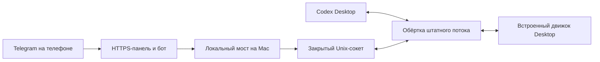

# Как Mac-адаптер подключает существующие чаты

Этот режим использует тот же локальный движок, которым управляет графическое приложение Desktop. Авторизация и профиль остаются у Desktop. Telegram служит дополнительным интерфейсом для разрешённой рабочей папки.

## Схема работы

Команда `launch` запускает установленное приложение с `CODEX_CLI_PATH`, заданным только для этого процесса. Обёртка передаёт штатные аргументы и протокол встроенному движку, а мост подключается через локальный сокет. Команда `run` сама движок не создаёт. Повторный `initialize` от Telegram-клиента не используется.

Это интеграция с внутренним механизмом запуска, а не официальный стабильный Telegram API. Основание разработки — статический анализ ветки macOS в общем коде Desktop, доступном в Windows-поставке. Это **не проверка установленной Mac-сборки**. Публичный протокол app-server помогает описать сообщения, но запуск отдельного app-server не доказывает подключение к существующему GUI. [Документация app-server](https://learn.chatgpt.com/docs/app-server).

OpenAI также документирует штатное удалённое управление из своих клиентов. Оно имеет собственные правила подключения и не даёт данному Telegram-адаптеру автоматического доступа. [Remote connections](https://learn.chatgpt.com/docs/remote-connections).

## Что допускается

- Только существующие локальные неархивные Codex-чаты с `cwd` внутри выбранной рабочей папки. Проверяется разрешённый путь, а не название чата или проекта.
- Чтение последних 100 текстовых записей; отправка сообщения, уточнение активной задачи, запрос остановки.
- Выбор модели и интенсивности для следующей задачи из каталога подключённого движка.
- Поддерживаемые вопросы и разовые разрешения, связанные с конкретным чатом, текущей задачей и исходным запросом.
- Загрузка файлов в рабочую область и получение явно подготовленных файлов из её `telegram-exports`.

Новые чаты создаются в Desktop. Облачные беседы ChatGPT, полная история аккаунта, другой компьютер, архивные чаты и worktree вне выбранной области в этот режим не входят. Совпадение отображаемого названия чата не заменяет проверку его ID.

Уже запущенная задача может продолжать работать при отключённом телефоне или остановленном мосте. Для её остановки используйте `/stop` либо сам Desktop. Успешная отправка команды остановки ещё не означает, что задача завершилась: дождитесь соответствующего состояния.

## Права и разрешения

Действуют настройки sandbox и подтверждений самого Desktop. Поле конфигурации переносимого CLI-ядра не меняет их; `configure.py --desktop --sandbox …` запрещён. Выбранная папка ограничивает чаты, доступные через мост, но не заменяет ограничения инструментов внутри Desktop.

Разрешение на телефоне доступно только при достаточном контексте: для команды показывается команда, для изменения файлов — изменения. Если деталей нет, разрешение блокируется; решение можно принять в Desktop. Защищённые вопросы, включая секретный ввод, остаются на Mac.

Обёртка учитывает ответ и с Mac, и с телефона. Первый принятый ответ резервирует исходный запрос; поздний повтор не должен выполняться. Ответ считается завершённым после события движка, а не после нажатия кнопки. Временное отключение или неизвестный исход не вызывают автоматическую повторную отправку. Это поведение проверяется отдельно на реальном приложении.

Токен бота хранится в Keychain либо подаётся процессу явно. Подключение к локальному сокету использует права пользователя, закрытый каталог и секрет текущего запуска. Не публикуйте каталог настроек, файлы сессии, журнал операций или снимки настоящих чатов. Полные границы доступа — в [SECURITY](../SECURITY.md).

## Подпись и совместимость

При настройке и запуске проверяются подпись OpenAI, идентификатор `com.openai.codex`, команда подписи `2DC432GLL2`, расположение исполняемых файлов и хеш встроенного движка. Эти идентификаторы соответствуют [официальному исходнику macOS launcher](https://github.com/openai/codex/blob/main/codex-rs/cli/src/desktop_app/mac.rs). Имя `ChatGPT.app` допустимо только для приложения с нужной идентичностью; Classic с другой идентичностью не подходит.

Приложение и его подпись не изменяются. Глобальная переменная окружения, правка `.app`, отключение Gatekeeper и доступ к приватному IPC в обход проверки клиента не нужны. При неизвестной структуре, изменённой версии или хеше адаптер прекращает подключение. Подпись подтверждает происхождение приложения, но не полную совместимость протокола.

## Команды

Выполняйте из папки установленного пакета:

| Команда | Назначение |
|---|---|
| `.venv/bin/codex-telegram-desktop setup` | Новая конфигурация; существующую не перезаписывает |
| `.venv/bin/codex-telegram-desktop launch` | После штатного выхода из Desktop запускает его с обёрткой |
| `.venv/bin/codex-telegram-desktop doctor` | Проверяет сборку и готовность соединения; не отправляет задание модели |
| `.venv/bin/codex-telegram-desktop run` | Telegram-мост в текущем терминале |
| `.venv/bin/codex-telegram-desktop set-token` | Скрытый ввод нового токена в Keychain; мост предварительно остановите |
| `.venv/bin/codex-telegram-desktop rollback` | После штатного выхода запускает Desktop без обёртки |

Настройки по умолчанию находятся в `~/Library/Application Support/codex-telegram-desktop`. При использовании `CODEX_TELEGRAM_HOME` один и тот же путь нужен для всех команд. Профиль Desktop остаётся прежним; переносить файлы авторизации в пакет не требуется.

## Сбой, перезапуск и откат

| Ситуация | Действие |
|---|---|
| Desktop уже работает | Дождитесь окончания задач, выполните Quit / Cmd+Q, затем `launch` |
| `doctor` не видит готовое соединение | Дождитесь открытия приложения, откройте нужный чат, повторите `doctor`; при устойчивом отказе вернитесь к обычному запуску |
| Чат отсутствует в списке | Проверьте фактическую рабочую папку, архивный статус и локальный тип чата; не расширяйте область до домашнего каталога |
| Нет выбранного чата | Явно выберите его через `/chats` и `/use номер` или панель |
| Mac спал, Desktop перезапущен или соединение потеряно | Проверьте исходный чат, остановите мост, выполните `doctor`, затем `run`; при новом запуске Desktop используйте `launch` |
| Исход отправки неизвестен | Проверьте историю на Mac до повторной отправки |
| Токен отозван | Получите новый токен собственного бота, остановите мост, выполните `set-token`, затем `run` |
| Сменился HTTPS-адрес | Примените `scripts/configure.py --desktop --public-url` по [инструкции](INSTALL_MACOS.md) |
| Desktop обновился и хеш изменён | Сначала проверьте новую официальную сборку и совместимость адаптера; не переписывайте сохранённый хеш вручную |

Для отката остановите мост через Ctrl+C, завершите Desktop штатно, затем выполните `rollback`. Профиль, чаты и приложение не удаляются. Если обновлённая сборка уже не проходит сохранённую проверку, откройте официальное приложение обычным способом из Finder: переменная обёртки не установлена глобально.

После обновления и проверки совместимости создайте новую конфигурацию в отдельной пользовательской папке через `CODEX_TELEGRAM_HOME` и `setup`. Используйте прежний профиль Desktop и рабочую папку, заново задайте свой токен. Для всех последующих команд сохраняйте выбранное значение переменной. Повторите приёмку, прежде чем вернуть постоянную работу через телефон.

## Критерий готовности

Должны совпасть исходный ID чата и ID в панели; сообщение и ответ появляются в том же чате без дублей; отдельный движок для бота не появляется; разрешения, остановка, перезапуск и восстановление после сна проверены. Совместимость требуется подтвердить для конкретной версии Desktop и архитектуры Mac. [Полный чек-лист](MOBILE_ACCEPTANCE.md).
